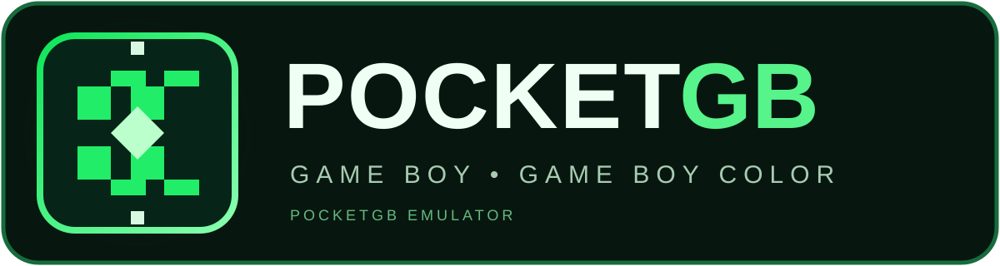

# PocketGB



PocketGB is a lightweight Windows desktop emulator for Nintendo Game Boy, Game Boy Color, and Game Boy Advance cartridges. It includes native mGBA support for GBA, save states, battery saves, keyboard/gamepad input, configurable display filters, window/fullscreen controls, a real frame-based fast-forward scheduler, and a self-contained runtime.

## Latest Windows build

The current release is **PocketGB 1.5.0**. Download the [Windows installer](https://github.com/siddop422/Pixel-Lab/releases/download/pocketgb-v1.5.0/PocketGB-Setup-1.5.0.exe), [portable ZIP](https://github.com/siddop422/Pixel-Lab/releases/download/pocketgb-v1.5.0/PocketGB-Portable-1.5.0.zip), or [Android APK](https://github.com/siddop422/Pixel-Lab/releases/download/pocketgb-v1.5.0/PocketGB-Android-1.5.0.apk). Verify Windows downloads with [SHA256SUMS.txt](https://github.com/siddop422/Pixel-Lab/releases/download/pocketgb-v1.5.0/SHA256SUMS.txt) and the APK with [SHA256-ANDROID.txt](https://github.com/siddop422/Pixel-Lab/releases/download/pocketgb-v1.5.0/SHA256-ANDROID.txt). See [all PocketGB releases](https://github.com/siddop422/Pixel-Lab/releases).

| Download | What it is |
| --- | --- |
| **PocketGB-Setup-1.5.0.exe** | Windows 10/11 x64 installer. Installs per-user and upgrades the existing PocketGB installation. |
| **PocketGB-Portable-1.5.0.zip** | Self-contained Windows x64 portable build. Extract and run `PocketGB.exe`. |
| **SHA256SUMS.txt / SHA256-ANDROID.txt** | SHA-256 hashes for Windows and Android downloads. |

The installer retains the same application ID and install folder, so running a newer setup over PocketGB 1.2.0 upgrades that installation instead of creating a second app entry. User configuration and game saves remain separate from the application directory.

**Safe download guidance:** download only from the official GitHub Releases page. Compare the installer/ZIP hash with `SHA256SUMS.txt` before running it. The installer is not Authenticode-signed; SmartScreen may show an unknown-publisher warning. A checksum confirms file integrity, not publisher identity.

## Android APK

PocketGB 1.5.0 also includes a native Android app for Android 6.0+ on ARM64, ARMv7, x86_64 and x86 devices. Download the [PocketGB Android APK](https://github.com/siddop422/Pixel-Lab/releases/download/pocketgb-v1.5.0/PocketGB-Android-1.5.0.apk) from the same release page.

The Android build uses the pinned native mGBA core for GB, GBC and GBA games, with a landscape display, touch D-pad/buttons, hardware-key input, Android file picker, stereo audio, pause/reset, speed/turbo, save states and battery saves. It supports `.gb`, `.gbc`, `.sgb`, `.gba` and ZIP archives containing one supported ROM. The universal APK bundles mGBA native libraries for `arm64-v8a`, `armeabi-v7a`, `x86_64` and `x86`, so it can install on 64-bit/32-bit ARM phones and supported x86 Android emulators.

Read the [Android install/build guide](android/README.md). The APK is signed for installation. For seamless updates across releases, configure a persistent signing key in GitHub Actions secrets; if CI uses its one-off fallback key, uninstall the older APK and back up its saves before installing a differently-signed future build.

## What's new in 1.5.0

- Native mGBA core for Game Boy Advance, Game Boy and Game Boy Color on Windows x64 and Android arm64, ARMv7, x86_64 and x86.
- Emulation core selector: Auto, GameboySharp (GB/GBC), and mGBA (GB/GBC/GBA).
- Auto prefers mGBA for `.gba`, `.gb`, `.gbc`, and `.sgb` files for broader compatibility; GameboySharp remains a selectable manual GB/GBC fallback.
- GBA output at 240×160 with dynamic aspect-ratio scaling; GB/GBC output remains 160×144.
- mGBA input mapping for GBA controls, stereo audio, battery saves, reset, and quick save/load state.
- Real frame-based speed multipliers and configurable Tab turbo (2×–16×); faster render FPS is shown separately from actual emulated game FPS.
- Core-only mGBA native DLL build, pinned upstream source revision, and MPL-2.0 notice included in the portable package.
- Reduced self-contained publish size by disabling ReadyToRun images; installer uses LZMA2/ultra64 compression.

## Systems and cartridge compatibility

| System / cartridge | Status |
| --- | --- |
| Original Game Boy (DMG) | GameboySharp core |
| Game Boy Color (CGB) | mGBA in Auto mode; GameboySharp selectable as fallback |
| Game Boy Advance (GBA) | mGBA native core in the Windows x64 build |
| Standard ROM-only, MBC1, MBC2, MBC3, and MBC5 | Implemented by GameboySharp |
| Standard ROM+RAM and ROM+RAM+battery (0x08/0x09) | Implemented by GameboySharp |
| Special GB ROM size codes 0x52/0x53/0x54 | Header parsing implemented |
| MBC6, MBC7, MMM01, HuC-1, HuC-3, TAMA5, Pocket Camera | Not implemented in GameboySharp; uncommon cartridge types are reported clearly |
| Super Game Boy enhancements | Not implemented |

mGBA is the recommended Auto core for GBA and GB/GBC because it supports a broader set of cartridge types; GameboySharp remains available as a manual GB/GBC fallback. No emulator can guarantee every game, peripheral, mapper, or ROM hack works perfectly. The automated suite includes generated native GBA and GB cartridge smoke tests; the uploaded Balatro GBA ROM and the Geometry Dash GB ROM have not been run in CI. Its local header check matches the GBA marker bytes recognised by mGBA.

No commercial ROMs or BIOS files are included. mGBA's HLE BIOS is used by default.

## Emulation backends

Open **Settings → General → Emulation core**:

| Option | Behaviour |
| --- | --- |
| **Auto (recommended)** | Prefers mGBA for `.gba`, `.gb`, `.gbc`, and `.sgb` for broader cartridge compatibility |
| **GameboySharp (GB/GBC)** | Uses the original Game Boy / Color core |
| **mGBA (GB/GBC/GBA)** | Uses the native mGBA core for supported GBA and GB/GBC images |

The mGBA core is a separate native library built from pinned upstream mGBA source. Auto uses it for all supported handheld ROM types; choose GameboySharp manually when you need the original GB/GBC core and its debugger/save-state features. mGBA is not a GameboySharp extension or a file-extension trick.

## Display and graphics

- Window resolution presets and custom window width/height.
- Fullscreen and V-Sync.
- Integer scaling and aspect-ratio preservation.
- Nearest-neighbour, bilinear, and sharp-bilinear filtering in the GameboySharp display.
- DMG green, grey, Pocket, and yellow palettes.
- Optional scanlines, LCD pixel grid, CRT curvature/vignette, brightness, and saturation.
- A low-end profile for weaker CPUs/GPUs.

**Graphics API:** OpenGL 3.3 Core is the only implemented graphics API. The mGBA window uses the same OpenGL presentation path. Vulkan and Direct3D are not exposed as working choices because their renderers have not been implemented. CPU-only window presentation is not implemented.

**Resolution note:** enlarging the desktop window only scales the console's original framebuffer. It does not create extra source detail.

## Speed and performance

Normal speed (0.5× / 1× / 2×) changes actual emulated frame advancement, not just the time the UI loop sleeps. Hold **Tab** for configurable turbo (2×–16×) in Settings → General. The top-right overlay reports **RENDER FPS**, **GAME FPS**, and measured emulation speed separately. Turbo reduces UI/GL redraw frequency so more time is available to the emulation core.

On lower-end hardware, use the Low-end / maximum performance profile, pixel-perfect scaling, and keep optional post-processing disabled. Performance depends on the game, audio output, driver and system load.

## Controls

| Game Boy / GBA action | Default keyboard key |
| --- | --- |
| D-pad | Arrow keys |
| A / B | Z / X |
| Start / Select | Enter / Right Shift |
| GBA L / R | A / S |
| Pause / resume | Space |
| Fast-forward (hold) | Tab |
| Quick save / load | F5 / F8 |
| Reset in mGBA window | F9 |
| Frame advance while paused (GameboySharp) | N |
| Show / hide GameboySharp debug tools | F11 |

Gamepad D-pad, face buttons, Start/Back and shoulder/trigger buttons are mapped where supported by the connected controller. Game Boy bindings can be changed in Settings.

## Saves and supported files

- Direct `.gb`, `.gbc`, `.sgb`, and `.gba` cartridge images.
- ZIP archives containing supported GB/GBC/GBA ROMs.
- GameboySharp: ten save-state slots, quick save/load and battery-backed `.sav` files, including MBC3 RTC data.
- mGBA: quick save/load state (`.state0`) and battery-backed `.sav` data.
- Saves are written beside the original ROM or ZIP, or to the optional configured save folder.
- ZIP extraction is cached; replacing an archive invalidates the old cache. Save files remain beside the original ZIP, not in the cache.
- ZIP entries are limited to 64 MiB. 7z and RAR archives are not supported.

## Requirements

- Windows 10/11 x64 for the desktop app.
- Android 6.0+ (API 23+) on 64-bit ARM (arm64-v8a) for the Android APK.
- OpenGL 3.3-compatible graphics driver.
- The application bundles its .NET runtime and native mGBA core; a separate .NET install is not required.
- Recent Intel, AMD, or NVIDIA graphics drivers are recommended.
- No external BIOS file is required for the default mGBA HLE BIOS setup.

## Build from source

The GameboySharp core is pinned as a Git submodule. mGBA is pinned separately and built as a minimal core-only native library.

```powershell
git clone --recurse-submodules https://github.com/siddop422/Pixel-Lab.git PocketGB
cd PocketGB
git clone https://github.com/mgba-emu/mgba.git third_party/mgba
git -C third_party/mgba checkout 431935616c0e216d650b25b2ea0c0acccd359038
pwsh ./scripts/Prepare.ps1
pwsh ./scripts/Build-Mgba.ps1
dotnet test ./vendor/GameboySharp/GameboySharp.sln -c Release
dotnet publish ./vendor/GameboySharp/GameboySharp.csproj -c Release -r win-x64 --self-contained true -p:AssemblyName=PocketGB -p:Version=1.5.0 -o publish
```

The native mGBA core is MPL-2.0 licensed; its notice is included with the Windows output. No game ROMs or BIOS dumps are included.

## Further technical notes

- [GBA backend and compatibility](docs/GBA-BACKEND-AND-COMPATIBILITY.md)
- [Stability and renderer backend roadmap](docs/STABILITY-AND-RENDER-BACKENDS.md)

## Credits and license

The GameboySharp emulation core is MIT-licensed; its license is preserved in `vendor/GameboySharp/LICENSE` and `THIRD-PARTY-NOTICES.md`. The mGBA native core is MPL-2.0-licensed and its notice is included in the Windows build output.

PocketGB is an independent community project and is not affiliated with or endorsed by Nintendo.
